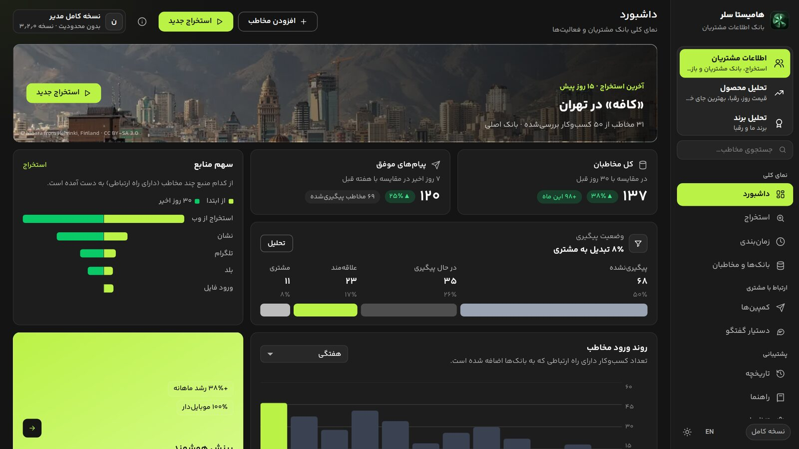
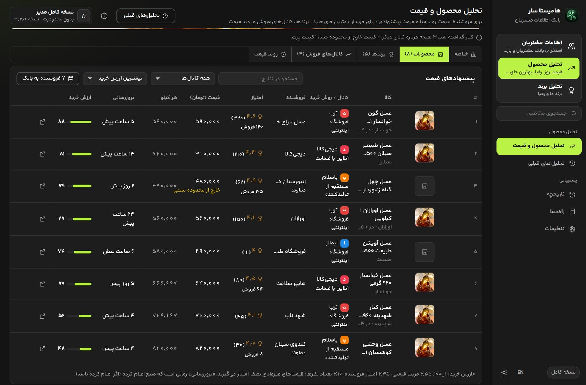
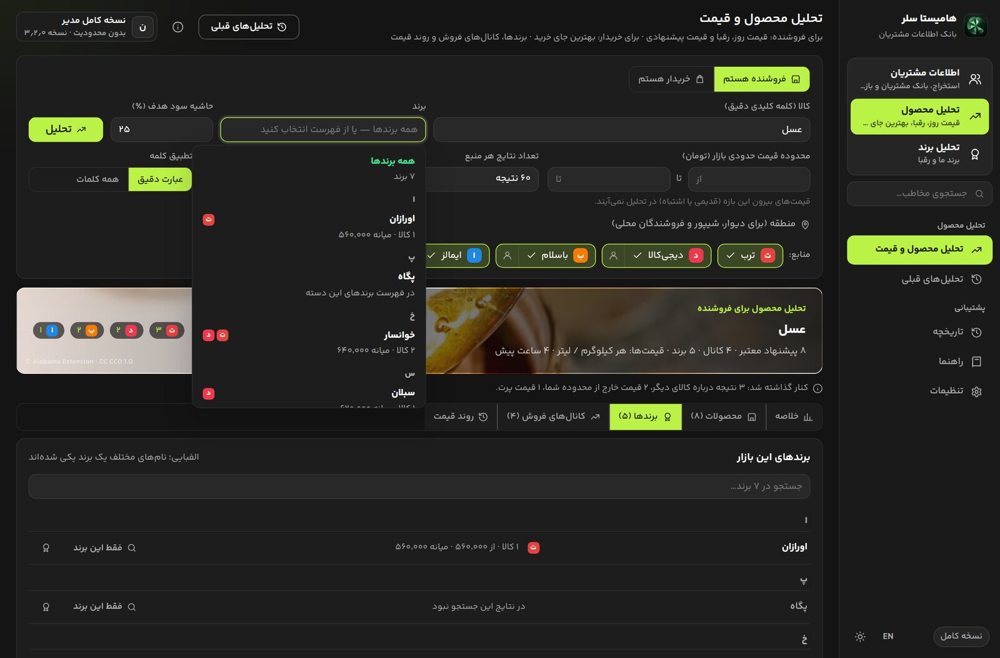
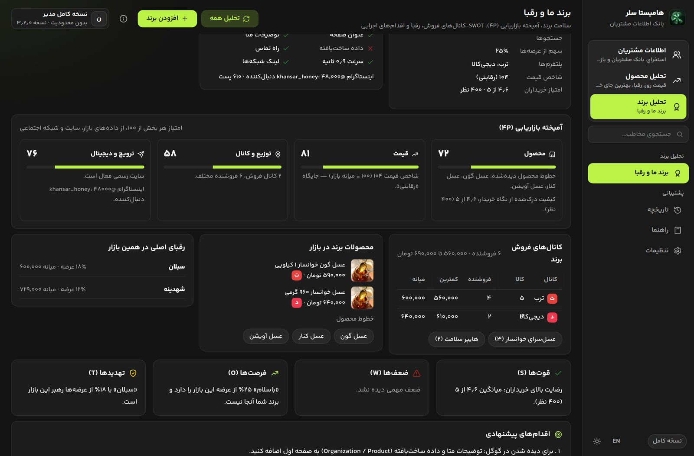

# هامیستا سلر ۳٫۳

<p align="center"></p>

**Hamista Seller** · تیم هامیستا · hamista.ir · تلگرام @hamistaa

سامانه مشتری‌یابی، قیمت‌یابی بازار و تحلیل برند. برنامه تک‌فایلی و پرتابل برای ویندوز (Tauri 2 + Rust).

## تصویر محیط برنامه

| داشبورد (اطلاعات مشتریان) | تحلیل محصول |
|---|---|
|  |  |
| **برندهای بازار (الفبایی)** | **تحلیل برند** |
|  |  |

**راهنمای کامل کاربر (PDF، ۱۷ صفحه):** [`docs/HamistaSeller-Guide.pdf`](docs/HamistaSeller-Guide.pdf)

## سه نسخه از یک کد

| نسخه | فایل آماده (پوشه `bin`) | ساخت از کد (در `src-tauri`) | لایسنس | کار |
|---|---|---|---|---|
| **فول مستر** (مخصوص شما) | `HamistaSeller-Master.exe` | `cargo build --release --features custom-protocol,master` | لازم ندارد | همه امکانات |
| **مشتری** | `HamistaSeller.exe` | `cargo build --release --features custom-protocol` | لازم دارد | همه امکانات، بعد از فعال‌سازی |
| **پنل مدیر** | `HamistaAdmin.exe` | `cargo build --release --features custom-protocol,issuer` | — | مشتریان، لایسنس آفلاین، و با اتصال به سرور: کاربران آنلاین، پلن‌ها، دوره آزمایشی، ابربانک، اعلان‌ها |

- **ساخت هر سه با یک دستور (ویندوز):** `build-all.cmd` را در ریشه پروژه اجرا کنید؛ سه exe با نام درست در پوشه `bin` قرار می‌گیرند. پیش‌نیاز فقط Rust و Visual Studio Build Tools (بخش C++) است.
- **ساخت خودکار در گیت‌هاب (بدون نصب چیزی):** با هر push به شاخه `main`، فایل `.github/workflows/build.yml` هر سه exe را روی ویندوزِ گیت‌هاب می‌سازد؛ از زبانه **Actions** ← آخرین اجرا ← بخش **Artifacts** فایل `HamistaSeller-exes` را دانلود کنید. اگر یک تگ مثل `v3.1.0` بزنید، exeها در بخش **Releases** هم منتشر می‌شوند.
- **امنیت مخزن:** مخزن را **خصوصی (Private)** نگه دارید؛ هر کسی کد را داشته باشد می‌تواند نسخه مستر بدون لایسنس بسازد. کلید خصوصی لایسنس (`KEYS-PRIVATE.txt`) عمداً داخل گیت نیست؛ فقط کلید عمومی `license.pub` هست.
- **سرور اختیاری:** کد سرور (hamista-cloud) در پوشه `server` همین مخزن است.
- **کلید لایسنس از قبل تنظیم شده است:** exeهای پوشه `bin` با کلید عمومی داخل `src-tauri\license.pub` ساخته شده‌اند. کلید خصوصی متناظر در فایل `KEYS-PRIVATE.txt` است: آن را در پنل مدیر از «کلید و پشتیبان ← ورود کلید خصوصی» وارد کنید، یک نسخه را جای امن نگه دارید و فایل را پاک کنید. اگر کلید خودتان را می‌خواهید، در پنل مدیر کلید تازه بسازید، `license.pub` را عوض کنید و با `build-all.cmd` دوباره بسازید.
- **داده‌ها:** کنار exe، در پوشه `HamistaSeller-Data`. پنل مدیر پوشه جدای `HamistaIssuer-Data` دارد تا کلید امضا با داده مشتری‌ها قاطی نشود.
- **آدرس سرور پیش‌فرض (اختیاری):** اگر سرور دارید، آدرسش (مثل `https://api.hamista.ir`) را در `src-tauri\server.url` بنویسید تا نسخه مشتری آن را از قبل داشته باشد. خالی بماند، مشتری خودش وارد می‌کند.
- **نسخه‌های دقیق کتابخانه‌ها:** فایل `Cargo.lock` همراه پروژه است؛ همان نسخه‌هایی که بررسی و تست شده‌اند نصب می‌شوند.
- **انتقال خودکار از SellerMap:** در اولین اجرا، اگر پوشه `SellerMap-Data` کنار exe باشد، بانک‌ها، مخاطبان، تاریخچه، لیست عدم ارسال و حساب‌های ارسال منتقل و رمزها رمزنگاری می‌شوند.

---

## تازه‌های نسخه ۳٫۳ (به‌روزرسانی آماده بازار)

- **دریافت لیست محصول (بخش جدید):** لینک هر فروشگاه را بدهید؛ نام، قیمت، عکس، لینک محصول، فروشنده، برند، امتیاز، تعداد نظر، فروش و تاریخ همه محصولات با یک خلاصه تحلیلی (کمترین/میانه/بیشترین قیمت، فروشندگان و برندهای پرتکرار) و **خروجی اکسل** دریافت می‌شود. محدوده دقیق از خود لینک: لینک **غرفه باسلام** فقط محصولات همان غرفه را می‌آورد (نه کل باسلام)؛ **صفحه اصلی** یک سایت کل سایت را؛ **یک صفحه** همان صفحه و صفحه‌های بعدی آن را؛ و **کانال عمومی تلگرام** پست‌ها را با قیمت نوشته‌شده، عکس، لینک پست، لینک محصول در سایت و تاریخ انتشار.
- **منبع «وب» در تحلیل محصول:** اول فهرست منابع؛ سایت خود برندها و فروشگاه‌های معتبر خوانده می‌شود و فروشگاه‌های دارای **اینماد** اول می‌آیند. به‌تنهایی هم قابل انتخاب است. با فیلد **«منبع دلخواه»** همه اطلاعات فقط از لینک داده‌شده (سایت، غرفه یا کانال) خوانده می‌شود.
- **هیچ‌وقت روی کپچا گیر نمی‌کند:** هر جا سایتی (مثلاً ترب) «ربات نیستم» یا ورود بخواهد، کنار پیام دکمه **«رد کردن و ادامه»** هست — در تحلیل محصول، استخراج، تحلیل برند، دریافت لیست محصول و پنل شناور عملیات‌ها. آن منبع رد می‌شود و بقیه ادامه می‌دهند.
- **تحلیل برند برای برندهای کوچک:** فیلد **«فروشگاه برند»** (غرفه باسلام، صفحه محصولات یا کانال تلگرام). تحلیل بر پایه محصولات، قیمت‌ها، امتیاز و نظرهای واقعی همان فروشگاه انجام می‌شود، با جایگاه قیمت نسبت به بازار و اقدام‌های عملی (عنوان‌گذاری با نام برند، نظر گرفتن، تنوع، سایت و اینماد، اینستاگرام). اگر هیچ چیز پیدا نشود، به‌جای گزارش خالی، دکمه **«تعریف برند»** نشان داده می‌شود.
- **استراتژی و بیزینس پلن (تحلیل برند):** با انتخاب حوزه کسب‌وکار و چند پاسخ (مدل، مرحله، هدف، مخاطب، مزیت، بودجه تبلیغات، قیمت، بهای تمام‌شده، هزینه ثابت، ظرفیت) یک برنامه حرفه‌ای ساخته می‌شود: خلاصه مدیریتی، **بوم کسب‌وکار ۹ بخشی**، **مدل کسب‌وکار** و جریان درآمد و استراتژی قیمت، **بیزینس پلن** (بازار، رقبا، عملیات، مجوزها، تیم)، **جایگاه‌یابی و برندینگ** (بیانیه جایگاه، کهن‌الگو، لحن، شعار، هویت، بسته‌بندی، داستان برند)، **برنامه تبلیغات** با تقسیم بودجه و شاخص هر کانال، تقویم محتوا و مناسبت‌ها، **نقشه رشد ۱۲ ماهه**، **اقتصاد واحد و پیش‌بینی مالی ۱۲ ماهه** (سربه‌سر، بازگشت سرمایه) و ریسک‌ها و KPI. ده حوزه با شناخت بازار ایران (غذایی، پوشاک، آرایشی، خانه، دیجیتال، صنایع دستی، سلامت، صنعتی B2B، خدمات، عمومی) و هر عدد بر پایه داده واقعی تحلیل برند. خروجی **چاپ / PDF**، کپی، و **نگارش کامل با هوش مصنوعی**؛ پاسخ‌ها ذخیره می‌شوند و برنامه با هر تحلیل تازه به‌روز می‌شود.
- **تلگرام و اینستاگرام:** پنجره سفید خالی برطرف شد (تب خالی شروع بسته و تب در حال کار جلو آورده می‌شود)؛ ورود به تلگرام هم اضافه شد؛ گروه‌های عمومی هم پیدا می‌شوند؛ **آیدی ادمین/سفارش** نوشته‌شده در بیو و توضیحات کانال به‌صورت لینک قابل کلیک ذخیره می‌شود و لینک خود کانال/پیج روی کارت مخاطب است.
- **اصلاحات تست‌شده روی سایت واقعی:** شماره تماس دیوار فقط با کلیک روی دکمه واقعی «اطلاعات تماس»، موتور جستجوی پشتیبان DuckDuckGo، عبور درخواست‌ها از VPN/پروکسی سیستم، خواندن اینستاگرام از مرورگر خود برنامه و نمایش خطاهای تحلیل بازار به‌جای گزارش خالی.

### پیش از این در ۳٫۳

- **مرکز عملیات:** هر عملیات سنگین (استخراج، تحلیل محصول/برند، پایش، کمپین) یک کار با شناسه، وضعیت و پیشرفت واقعی است. چند عملیات می‌توانند هم‌زمان اجرا شوند و در یک پنل شناور پایین سمت چپ همه‌جا دیده می‌شوند؛ هر کدام دکمه **توقف** مستقل دارد و توقف واقعی است (درخواست‌ها لغو و مرورگر بسته می‌شود، داده‌های تا آن لحظه حفظ می‌ماند).
- **لینک دقیق هر مورد:** هر پیشنهاد به لینک **همان کالا** و در صورت وجود **همان غرفه/فروشنده** وصل می‌شود، نه صفحه اصلی یا جستجوی سایت. نشان **«✓ لینک دقیق»** / **«⚠ تأییدنشده»** اعتبار لینک را مشخص می‌کند.
- **جستجوی چندکالایی و هوشمند:** در کادر نام کالا می‌توانید چند کالا را با «+» یا «یا» بیاورید و با «-» کلمه‌ای را حذف کنید (مثل «عسل یک کیلویی + شهد آزادی -موم»). «عسل یک کیلویی»، «۱ کیلویی»، «1kg» و «۱۰۰۰ گرم» هم‌ارز شناخته می‌شوند و ایرادهای جزئی نگارشی مانع نتیجه نمی‌شوند.
- **منابع وب:** تا ۳ نتیجه ارگانیک معتبر (سایت رسمی، تولیدکننده، فروشگاه) با خواندن داده ساخت‌یافته صفحه (JSON-LD، OpenGraph).
- **تأمین عمده و B2B:** حالت «خریدار عمده / B2B» تولیدکننده‌ها، عمده‌فروش‌ها، پخش‌کننده‌ها و واردکننده‌ها را از خرده‌فروش جدا می‌کند و برای هرکدام کارت با نوع، اعتماد داده و لینک مستقیم می‌سازد؛ با **«درخواست استعلام قیمت»** یک متن حرفه‌ای آماده می‌شود (ارسال خودکار انجام نمی‌شود).
- **تحلیل برند واقعی:** از نام برند، هویت صحیح پیدا می‌شود؛ اگر نام مبهم باشد، به‌جای حدس، نامزدهای محتمل نمایش داده می‌شوند. هر تحلیل **اعتماد داده** و **منبع** دارد و از سلامت برند جداست.
- **کالاهای یکسان:** آگهی‌های یک کالا در سایت‌های مختلف یکی می‌شوند؛ برند، وزن، تعداد در بسته، کد مدل و نوع (Pro/Max) باید یکی باشند.
- **پایش روزانه قیمت:** بررسی خودکار هر روز سر ساعت دلخواه، تغییر ۷ و ۳۰ روزه، نوسان و هشدار.
- **کالاهای من:** ورود فهرست کالا از اکسل/CSV، شناسایی هر کالا در بازار حتی با نام متفاوت، جایگاه قیمت و قیمت پیشنهادی.
- **تاریخچه قیمت به تفکیک منبع** و جدا برای هر برند.
- **هوش مصنوعی:** Gemini یا حالت هوش مصنوعی گوگل در مرورگر خودتان، با سؤال آماده و خلاصه تحلیل.

## تازه‌های نسخه ۳٫۲

- **نام‌های تازه:** «اطلاعات مشتریان»، «تحلیل محصول» و «تحلیل برند»؛ سوییچر سه‌تایی دیگر بریده نمی‌شود.
- **تحلیل محصول:** حالت فروشنده/خریدار، بازه قیمت دلخواه، تعداد نتیجه از هر منبع (تا ۲۰۰؛ چند صفحه خوانده می‌شود)، ترتیب در منبع (پرفروش، پربازدید، ارزان، گران، جدید)، تطبیق دقیق/گسترده (چوب پینگ پنگ ≠ میز پینگ پنگ)، تحمل غلط نوشتاری (کیسه فریز/فریزر)، منطقه برای دیوار و شیپور.
- **نتیجه در زبانه‌ها:** خلاصه، محصولات (عکس، نام کامل، نشان منبع، زمان به‌روزرسانی، مرتب‌سازی جدیدترین/فروش/نظر…)، برندها (الفبایی و بدون تکرار)، کانال‌ها، تاریخچه.
- **فهرست برند:** کامبوباکس الفبایی از برندهای واقعی بازار؛ اگر برند نبود، تایپ کنید.
- **ورود و کپچا:** اگر سایتی ورود یا «ربات نیستم» بخواهد، پنجره مرورگر برای کاربر باز می‌شود و کار بعد از آن ادامه پیدا می‌کند (از جمله خطای موتور جستجو).
- **بازار این ماه:** کالاهای پرجستجوی ۳۰ روز اخیر با تغییر قیمت، به جای دسته‌های ثابت.
- **تحلیل برند:** فقط نام کافی است؛ سایت و اینستاگرام پیدا می‌شود، کالا و برند در بازار جستجو می‌شود، و گزارش آمیخته 4P، کانال‌ها، محصولات، فروشندگان، رقبا و SWOT ساخته می‌شود.
- **تاریخچه:** زبانه‌های جدا برای تحلیل محصول و تحلیل برند (با تغییر امتیاز).
- طراحی تخت‌تر، پایگاه داده v9 (`brand_runs`).

## تازه‌های نسخه ۳٫۱

| بخش | تغییر |
|---|---|
| **طراحی** | پوسته تازه بر اساس کیت ارسالی (Fitness Dashboard UI Kit): زمینه تیره ‎#161616، کارت‌های شیشه‌ای ۱۰٪ سفید با گوشه ۱۲، رنگ تأکید لیمویی ‎#BBF246، هاله‌های نرم پس‌زمینه. حالت تیره پیش‌فرض است و حالت روشن هم با همان ساختار ساخته شد |
| **حرکت و سرعت** | ورود نرم صفحه‌ها و کارت‌ها (پلکانی)، صفحه قبلی تا آماده شدن صفحه بعد کم‌رنگ می‌ماند و فقط اگر بارگذاری طول بکشد اسکلت بارگذاری نمایش داده می‌شود، همه صفحه‌ها در زمان بیکاری از قبل بارگذاری می‌شوند، فونت از قبل بارگذاری می‌شود، حرکت‌ها فقط با transform/opacity (بدون لگ) و با تنظیم «کاهش حرکت» ویندوز خاموش می‌شوند |
| **عکس‌ها** | ۵۲ عکس با مجوز Creative Commons (۳۱ مرکز استان، ۱۲ حوزه کسب‌وکار، ۱۲ دسته کالا؛ ۳٫۲ مگابایت WebP) داخل برنامه؛ بنر صفحه استخراج با انتخاب استان/شهر عکس همان محدوده را نشان می‌دهد و برای شهرهای دیگر عکس از ویکی‌پدیای فارسی گرفته و ذخیره می‌شود. نام عکاس روی هر عکس و فهرست کامل در `ui/img/CREDITS.md` |
| **داشبورد** | بنر آخرین استخراج با عکس همان شهر و کارت‌های «شروع سریع» که فرم استخراج را با همان کلمه باز می‌کنند |
| **محصول و قیمت** | دیوار و شیپور به منابع قیمت اضافه شدند (پیش‌فرض خاموش؛ فقط عنوان و قیمت آگهی، بدون اطلاعات تماس)؛ ستون «روش خرید»؛ کارت‌های عکس‌دار «دسته‌های پرجستجو»؛ بنر عکس‌دار گزارش؛ اصلاح لینک کالاها (قبلاً لینک‌های نسبی همه سایت‌ها به ترب می‌رفت) |
| **راهنما** | راهنمای PDF شکیل ۱۵ صفحه‌ای با تصویر همه بخش‌ها (`docs/HamistaSeller-Guide.pdf`)؛ منبع آن در `docs/guide` و با `python3 docs/guide/build.py out.pdf` دوباره ساخته می‌شود |

## تازه‌های نسخه ۳٫۰

برنامه سه **فضای کاری** دارد (سوییچر بالای منوی کناری):

| فضا | صفحه‌ها | کار |
|---|---|---|
| **مشتری‌یابی** | داشبورد، استخراج، بانک‌ها، مخاطبان، کمپین‌ها، دستیار گفتگو، زمان‌بندی | همان امکانات نسخه ۲٫۵: استخراج اطلاعات عمومی کسب‌وکارها، CRM و بازاریابی |
| **محصول و قیمت** | تحلیل قیمت و بازار، جستجوهای ذخیره‌شده | قیمت‌های عمومی ترب، دیجی‌کالا، باسلام و ایمالز؛ حذف قیمت پرت (IQR)؛ کمترین، بیشترین، میانه و میانگین وزنی (وزن = اعتبار فروشنده)؛ مقایسه بر اساس هر کیلو/لیتر وقتی وزن در عنوان باشد؛ **قیمت پیشنهادی فروش** = بهای تمام‌شده × (۱ + حاشیه هدف) محدود به بازه رقابتی p25–p75 و گرد شده به قیمت قفسه‌ای؛ «ارزش خرید» هر عرضه (۵۵٪ قیمت، ۳۵٪ امتیاز، ۱۰٪ تعداد نظر)؛ پیشنهاد «از کجا بخرید / کجا بفروشید»؛ تراشه‌های دسته (تاکسونومی) و برند با فیلتر برند دلخواه؛ سهم برندها و پلتفرم‌ها با نمودار؛ توزیع قیمت (اقتصادی/رقابتی/میان‌رده/پریمیوم)؛ **روند قیمت تاریخی** از جستجوهای ذخیره‌شده با نمودار و تاریخ شمسی؛ «افزودن فروشندگان به بانک» با یک کلیک |
| **تحلیل برند** | برند ما و رقبا | شاخص سلامت برند از چهار ستون: حضور در بازار، کیفیت درک‌شده، حضور دیجیتال (سلامت فنی سایت: HTTPS، سرعت، عنوان، توضیحات متا، داده ساخت‌یافته، راه تماس)، شبکه اجتماعی (اندازه پیج عمومی اینستاگرام). شاخص قیمت (۱۰۰ = میانه بازار)، نقشه جایگاه قیمت/کیفیت، نقاط قوت، ضعف و اقدام‌های پیشنهادی، و مقایسه ستون به ستون با هر رقیب |

- **طراحی:** پوسته Material 3 (نقش‌های رنگی تونال، دکمه‌های گرد، فیلدهای ۴dp، کارت ۱۲dp، دیالوگ ۲۸dp، نشانگر منوی کپسولی) برای هر دو حالت روشن و تیره.
- **پایگاه داده نسخه ۸:** جدول‌های `market_runs` (هر تحلیل قیمت با گزارش کامل؛ پایه روند تاریخی) و `brands`.
- **اصلاح از راه دور:** اگر ساختار سایتی عوض شد، در پنل مدیر سناریوی `market.<id>.api` یا `market.<id>.page` (id: torob, digikala, basalam, emalls) را بدون ساخت دوباره برنامه تنظیم کنید.
- **عمداً ساخته نشده:** استخراج شماره آگهی‌دهندگان دیوار/شیپور (اطلاعات شخصی فروشندگان خرد)، خروجی گرفتن از دنبال‌کنندگان اینستاگرام و اعضای گروه تلگرام، چرخش حساب و اسپینتکس برای دور زدن محدودیت ضد اسپم، بررسی انبوه ثبت‌نام شماره‌ها در پیام‌رسان‌ها. این‌ها هم خلاف قوانین آن پلتفرم‌ها و حریم خصوصی‌اند و هم حساب‌ها را مسدود می‌کنند.
- **وضعیت تست:** موتور قیمت با داده ساختگی و مرورگر واقعی تست شده است؛ سایت‌های ایرانی از محیط ساخت در دسترس نبودند، پس اولین اجرای واقعی را روی ویندوز با اینترنت ایران انجام دهید.

## تازه‌های نسخه ۲٫۵

| بخش | تغییر |
|---|---|
| **فهرست مخاطبان** | ردیف‌ها شماره‌گذاری شده‌اند؛ «موبایل» و «تلفن ثابت» دو ستون جدا هستند؛ ستون «کارت» حذف شد و کلیک روی هر ردیف کارت را باز می‌کند؛ آیکن راه‌های دیگر (ایمیل، سایت، اینستاگرام، تلگرام، ایتا، بله، واتساپ) هر کدام رنگ خودش را دارد |
| **کارت مشتری** | جمع‌وجور و دوستونه: راست «راه‌های ارتباطی» (همه شماره‌ها، ایمیل، سایت و شبکه‌ها با کپی و باز کردن)، چپ «مشخصات» و وضعیت و یادداشت. اگر کسب‌وکار در صفحه عمومی‌اش عکس داشته باشد، کنار نام نمایش داده می‌شود؛ عکس جزو داده‌های خروجی (Excel/CSV/vCard) و بانک جامع نیست |
| **حساب پیام‌رسان هر شماره** | در «دستیار گفتگو» با «ارسال کردم» یا «حساب ندارد»، کنار هر موبایل علامت رنگی واتساپ/تلگرام/ایتا/بله (دارد) یا علامت خط‌خورده (ندارد) ثبت می‌شود و در صف‌های بعدی می‌شود شماره‌های بدون حساب را رد کرد. بررسی خودکار و انبوه شماره‌ها در پیام‌رسان‌ها عمداً ساخته نشده: خلاف قوانین آن‌ها و باعث مسدود شدن حساب شماست |
| **دستیار گفتگو** | ورود با حساب شخصی خودتان (واتساپ، تلگرام، ایتا، بله) داخل برنامه؛ «ورود / تغییر حساب» صفحه پیام‌رسان را باز می‌کند و «خروج کامل» ورود ذخیره‌شده را پاک می‌کند. روبیکا حذف شد |
| **کمپین‌ها** | سه قدم روشن: مخاطبان ← روش ارسال ← متن. روش «پیامک خودکار» از پنل پیامک شما با پیش‌نمایش، تعداد پیامک و زمان تقریبی؛ روش «پیام‌رسان با حساب خودتان» صف را مستقیم در دستیار گفتگو می‌سازد. ارسال ایمیل، بله‌سفیر، ایتایار و پست کانال حذف شدند (کتابخانه ایمیل هم از برنامه خارج شد) |
| **دقت داده** | علامت‌های اضافه آدرس (مثل □) و ویرگول‌های تکراری پاک می‌شوند؛ در حالت «همه شهرهای استان»، شهرستان هر کسب‌وکار از آدرسش تشخیص داده و ذخیره می‌شود |

## تازه‌های نسخه ۲٫۴

| بخش | تغییر |
|---|---|
| **یک منبع ساده** | در صفحه «استخراج» دیگر انتخاب منبع وجود ندارد. یک استخراج واحد («استخراج از وب») بدون نیاز به کلید API انجام می‌شود: جستجوی کسب‌وکارها، خواندن مشخصات (نام، موبایل، تلفن ثابت، آدرس، سایت، ساعت کاری)، تکمیل از سایت خود کسب‌وکار (ایمیل، شبکه‌ها، نام مدیر)، استانداردسازی شماره‌ها و حذف تکراری‌ها. نام سرویس‌های پشت آن در نسخه مشتری نمایش داده نمی‌شود. موتورهای نشان، بلد، تلگرام و اینستاگرام در کد مانده‌اند ولی در این نسخه عرضه نمی‌شوند؛ برای برگرداندن هر کدام کافی است ردیفش به فهرست `SOURCES` در `sources.rs` اضافه شود |
| **محدوده دقیق** | زبانه کوچک «شهرستان / شهر و منطقه»: «همه شهرهای استان» (اول فهرست شهرستان‌ها) همه شهرستان‌های استان را یکی‌یکی جستجو می‌کند؛ یک شهرستان، خودش و محله‌های اطراف را؛ و «شهر / منطقه» فقط همان شهر، منطقه یا محله را (مثلاً «تجریش» یا «منطقه ۵») بدون گسترش، برای دقیق‌ترین خروجی. در زمان‌بندی هم همین انتخاب وجود دارد |
| **طراحی رسمی و جمع‌وجور** | قلم ۱۳، کنترل‌های ۳۲ تا ۳۴ پیکسلی، کارت‌های ساده با حاشیه نازک، رنگ‌های اداری. کل فرم استخراج در یک صفحه ۱۳۶۶×۷۶۸ ویندوز بدون اسکرول دیده می‌شود (این مورد در تست خودکار بررسی می‌شود) |
| **فهرست‌های کشویی** | فلش یکسان برای همه فهرست‌ها، با رنگ مطابق حالت روشن و تیره، فونت یکان‌بخ در گزینه‌ها و سازگار با راست‌به‌چپ و انگلیسی |
| **بانک جدید** | دکمه «بانک جدید» کنار فهرست بانک مقصد در صفحه استخراج، و در پایین فهرست بانک‌ها در «بانک‌ها و مخاطبان» |
| **پایداری مرورگر** | مرورگر را خود برنامه اجرا و مدیریت می‌کند: قبل از هر اجرا و در شروع و خروج برنامه، مرورگرهای جامانده همین برنامه بسته می‌شوند (پنجره سفید باقی نمی‌ماند)؛ اگر مرورگر فوراً بسته شود با پروفایل تازه و سپس مرورگر دیگر (Edge یا Chrome) دوباره تلاش می‌شود؛ جزئیات خطا در `browser-last.log` |
| **ساده‌تر** | علامت Ctrl K از کادر جستجو حذف شد (میان‌بر هنوز کار می‌کند) |

## تازه‌های نسخه ۲٫۳

| بخش | چه چیزی اضافه شد |
|---|---|
| **طراحی تازه** | داشبورد کارتی با پس‌زمینه شیشه‌ای: کل مخاطبان و رشد ۳۰ روزه، پیام‌های موفق هفته نسبت به هفته قبل، «سهم منابع» (کل و ۳۰ روز اخیر)، قیف وضعیت پیگیری با درصد، نمودار «روند ورود مخاطب» هفتگی یا روزانه با راهنمای مقدار، و کارت «بینش هوشمند» که از داده‌های خود شما پیشنهاد می‌سازد |
| **انتخاب منبع** | کارت برای هر منبع با رنگ و آیکون، تعداد مخاطب و تعداد ۳۰ روز اخیر، هشدار «نیاز به کلید API»، و دکمه «همه منابع / فقط یک منبع» |
| **ماژول‌های قابل خاموش و روشن** | «تنظیمات ← ماژول‌ها»: هر منبع (گوگل‌مپ، نشان، بلد، تلگرام، اینستاگرام) و «خواندن سایت کسب‌وکار» کلید روشن/خاموش دارد. ماژول خاموش از صفحه استخراج و زمان‌بندی‌ها حذف می‌شود؛ حداقل یک منبع همیشه روشن می‌ماند |
| **زمان‌بندی** | استخراج یک‌باره، روزانه یا هفتگی در ساعت دلخواه، با «اجرای بعدی»، «آخرین نتیجه» و «اجرا همین حالا» |
| **پس‌زمینه** | آیکون کنار ساعت ویندوز (نمایش، توقف عملیات، خروج کامل)، ماندن در سینی با بستن پنجره، اجرای خودکار همراه ویندوز، جلوگیری از اجرای دو نسخه هم‌زمان |
| **راهنما و پشتیبانی** | صفحه «راهنما» (شروع سریع، راهنمای هر صفحه، کدام منبع برای چه کاری، واژه‌نامه، خطاهای رایج) و دکمه راهنمای همان صفحه در بالا؛ «ساخت گزارش برای پشتیبانی» فایل متنی بدون رمز و کلید می‌سازد |
| **دوره آزمایشی آنلاین** | مدیر در پنل («پلن‌ها ← دوره آزمایشی») پلن و تعداد روز را تعیین می‌کند؛ مشتری در «لایسنس ← حساب آنلاین» با نام و موبایل یک بار برای هر کامپیوتر و هر شماره دوره رایگان می‌گیرد (حداکثر ۵ درخواست در روز از هر شبکه؛ پلن آزمایشی نمی‌تواند به بانک جامع دسترسی داشته باشد) |
| **رابط انگلیسی** | دکمه «EN / فا» در پایین منو؛ همه برچسب‌ها انگلیسی و چپ‌به‌راست می‌شوند و داده‌های شما (نام کسب‌وکار، یادداشت، آدرس) دست‌نخورده می‌مانند |

## مدل ترکیبی: بدون سرور شروع کنید، هر وقت خواستید آنلاین شوید

| | بدون سرور (حالا) | با سرور (هر وقت گرفتید) |
|---|---|---|
| **پنل مدیر** | دفتر مشتریان، صدور و تمدید لایسنس آفلاین، سابقه لایسنس‌ها، یادآوری تمدید، خروجی CSV | همه موارد ستون قبل، به‌علاوه: کاربران آنلاین، پلن‌ها، دستگاه‌ها، تعلیق از راه دور، ابربانک، اعلان‌ها، نسخه جدید، سناریوی استخراج و گزارش فعالیت |
| **نسخه مشتری** | «کد آفلاین» (`HS2.…`) | «حساب آنلاین» (نام کاربری و رمز)؛ کد آفلاین هم کار می‌کند |
| **کنترل** | انقضا و یک کامپیوتر | به‌علاوه: سقف دستگاه، سهمیه ماهانه استخراج و ارسال، منابع مجاز، تعلیق یا مسدود کردن دستگاه از راه دور (در اولین همگام‌سازی)، حداکثر ۷۲ ساعت کار بدون اینترنت |

- **یک کلید برای هر دو حالت:** سرور با همان کلید پنل مدیر امضا می‌کند (`HAMISTA_SIGNING_SEED`)، پس یک `license.pub` هم کد آفلاین و هم حساب آنلاین را تأیید می‌کند. لازم نیست نسخه مشتری را برای آنلاین شدن دوباره بسازید.
- **راه‌اندازی سرور:** راهنمای قدم‌به‌قدم داخل خود پنل مدیر است (صفحه «اتصال سرور»)؛ متن کامل تنظیمات سرور هم همان‌جا با کلید شما ساخته می‌شود. نسخه متنی آن در `server/README.md` است.
- **ابربانک (شفاف):** در حالت آنلاین، فقط **اطلاعات عمومی کسب‌وکارهایی که موتورها از منابع عمومی پیدا می‌کنند** به سرور می‌رود. یادداشت، وضعیت پیگیری، برچسب، شماره‌هایی که مشتری دستی وارد کرده، فایل‌های واردشده و سابقه کمپین هرگز نمی‌روند. این موضوع هنگام ورود به حساب آنلاین به مشتری اعلام می‌شود و باید آن را بپذیرد. در «تنظیمات ← درباره» هم همیشه نوشته شده است.

## لایسنس آفلاین — راهنمای کامل

### لایسنس چطور به مشتری می‌رسد و بررسی می‌شود

1. مشتری برنامه را اجرا می‌کند و **کد سیستم** (مثل `3F25-04E0-4F89-11D3`) را برایتان می‌فرستد. این کد از شناسه یکتای ویندوز همان کامپیوتر ساخته می‌شود.
2. در **پنل مدیر** («صدور لایسنس» یا «مشتریان ← تمدید»)، کد سیستم، نام مشتری، نوع و تاریخ انقضا را وارد می‌کنید. برنامه با **کلید خصوصی شما** امضا می‌کند و کد `HS2.…` می‌سازد.
3. کد را با تلگرام یا ایمیل برای مشتری می‌فرستید و او آن را در «کد لایسنس» می‌چسباند.
4. نسخه مشتری **بدون اینترنت** این موارد را بررسی می‌کند:
   - امضا با **کلید عمومی** داخل exe (هر تغییری در کد یا تاریخ، امضا را باطل می‌کند)
   - یکی بودن کد سیستم با همین کامپیوتر
   - نگذشتن تاریخ انقضا و عقب نکشیدن ساعت ویندوز
5. لایسنس ذخیره می‌شود و در هر اجرا، و قبل از هر استخراج، ارسال، دستیار گفتگو و خروجی، در هسته برنامه دوباره بررسی می‌شود.

### یک بار، برای راه‌اندازی

1. پنل مدیر را build و اجرا کنید (`--features issuer`).
2. از «کلید و پشتیبان»، **کلید عمومی** را کپی کنید.
3. فایل `src-tauri\license.pub` را باز کنید، متن داخلش را پاک کنید و کلید را جایگزین کنید. فقط یک خط ۶۴ کاراکتری.
4. نسخه مشتری را build کنید (`build-all.cmd`). اگر پنل مدیر را هم دوباره build کنید، پیام «این کلید با فایل license.pub این build یکی است» نمایش داده می‌شود.
5. **از کلید خصوصی پشتیبان بگیرید:** «نمایش کلید خصوصی» را بزنید و آن را جایی امن (خارج از این کامپیوتر) نگه دارید.
   - هر کس این کلید را داشته باشد می‌تواند لایسنس بسازد.
   - اگر گم شود، باید کلید تازه بسازید، نسخه مشتری را دوباره build کنید و برای همه مشتری‌ها لایسنس جدید صادر کنید.
   - کلید روی همین کامپیوتر با DPAPI رمز شده است. برای انتقال به کامپیوتر دیگر از «ورود کلید خصوصی» و همین پشتیبان استفاده می‌شود.

### برای هر مشتری

| مرحله | مشتری | شما (پنل مدیر) |
|---|---|---|
| ۱ | برنامه را اجرا می‌کند و **کد سیستم** (مثل `3F25-04E0-4F89-11D3`) را برایتان می‌فرستد | — |
| ۲ | — | در پنل مدیر: کد سیستم، نام مشتری، نوع («سالانه»، «ماهانه»، «آزمایشی») و **تاریخ انقضا** را وارد و «صدور» را می‌زنید. کد `HS2.…` خودکار کپی می‌شود |
| ۳ | کد را در کادر «کد لایسنس» می‌چسباند و «فعال‌سازی» را می‌زند | — |

- **تمدید:** در «مشتریان» دکمه کلید کنار مشتری را بزنید؛ مدت‌های سریع («+ ۱ سال» و…) از **پایان اعتبار فعلی** حساب می‌شوند، نه از امروز. مشتری کد جدید را جایگزین می‌کند.
- **دفتر مشتریان:** هر لایسنسی که صادر می‌شود کارت مشتری را می‌سازد یا به‌روز می‌کند (بر اساس کد سیستم). فیلترهای «رو به اتمام» (۱۴ روز) و «منقضی» و داشبورد مدیر تمدیدها را یادآوری می‌کنند.
- **نسخه آزمایشی:** همان روش، با انقضای ۳ یا ۷ روزه و نوع «آزمایشی».
- **هشدار انقضا:** از ۷ روز مانده به انقضا، به مشتری هشدار نمایش داده می‌شود. بعد از انقضا، استخراج، ارسال و خروجی متوقف می‌شوند، ولی داده‌های مشتری حفظ و قابل مشاهده می‌مانند.
- **سیستم دیگر:** هر لایسنس فقط روی همان کامپیوتر کار می‌کند. اگر مشتری ویندوز را دوباره نصب کند یا کامپیوترش را عوض کند، کد سیستم تغییر می‌کند و باید لایسنس تازه صادر کنید.
- **عقب کشیدن ساعت:** اگر تاریخ ویندوز به عقب برگردانده شود، برنامه قفل می‌شود تا تاریخ درست شود.
- **محدودیت واقعی:** لایسنس آفلاین برای مشتری عادی کاملاً کافی است، ولی هیچ لایسنس آفلاینی در برابر مهندسی معکوس حرفه‌ای ۱۰۰٪ مقاوم نیست و از راه دور باطل نمی‌شود. برای کنترل کامل، حساب آنلاین (با سرور) را به کار ببرید.

---

## رابط کاربری (فاز ۴)

راست‌چین، فونت یکان بخ (۳۰۰ / ۴۰۰ / ۵۰۰)، حالت روشن و تیره، بدون هیچ استایل درون‌خطی (سازگار با CSP).

| صفحه | کار |
|---|---|
| **داشبورد** | کل مخاطبان و روند هفته، موبایل، ایمیل و شبکه‌ها، نام مسئول، نمودار ۳۰ روز، قیف پیگیری، هشدار مشتریان علاقه‌مند پیگیری‌نشده، کلمات و شهرهای برتر |
| **استخراج** | فرم استان، شهر و کلمات؛ پیشرفت زنده، گزارش، مخاطبان تازه؛ پیام تأیید گوگل؛ «ادامه» برای استخراج‌های نیمه‌تمام |
| **بانک‌ها و مخاطبان** | **نام کامل در دو خط و نام مسئول/مدیر زیر نام برند**؛ فیلتر استان، شهرستان، حوزه کاری، کلمه، وضعیت، راه ارتباطی و برچسب؛ انتخاب گروهی (حتی همه نتایج)؛ تغییر وضعیت، برچسب، کپی/انتقال، کمپین، دستیار، خروجی، حذف؛ ورود Excel/CSV |
| **تحلیل و تفکیک** (داخل بانک‌ها) | تفکیک هر بانک **به استان، شهرستان، حوزه کاری، کلمه کلیدی، وضعیت پیگیری و پوشش راه‌های ارتباطی** با تعداد و درصد. روی هر مورد بزنید تا ریزتر شوید (مثلاً تهران ← شهریار ← کافه)؛ «فهرست همین بخش»، «خروجی همین بخش» و کمپین روی همان بخش کار می‌کنند |
| **کارت مشتری** | همه اطلاعات بدون بریدگی، کپی و باز کردن هر راه ارتباطی، گفتگو در واتساپ/تلگرام، وضعیت و یادداشت، ویرایش |
| **کمپین‌ها** | حساب، گیرندگان، متن با جای‌نگهدار و پیش‌نمایش واقعی، شمارش پیامک فارسی، ارسال آزمایشی، پیشرفت زنده؛ پست در کانال؛ سابقه |
| **دستیار گفتگو** | صف افراد، باز کردن گفتگو در پیام‌رسان داخل برنامه، متن آماده، «ارسال کردم، بعدی» |
| **تاریخچه** | استخراج‌ها با دکمه «ادامه»، کمپین‌ها، رویدادها |
| **تنظیمات** | مرورگر و سرعت، حساب‌های ارسال (۱۰ پنل پیامک آماده + سفارشی، ایمیل، بله‌سفیر، ایتا، روبیکا)، قالب‌ها، لیست عدم ارسال، پشتیبان و بازگردانی، لایسنس، درباره |
| **بانک جامع** (مشتری آنلاین، اگر پلن اجازه دهد) | جستجو در بانک مشترک کسب‌وکارها با استان، شهر و حوزه، انتخاب و افزودن به بانک خودتان (تکراری‌ها رد می‌شوند) |
| **اعلان‌ها و نسخه جدید** (مشتری آنلاین) | زنگوله اعلان با شمارنده خوانده‌نشده؛ بنر «نسخه جدید» وقتی مدیر نسخه تازه منتشر کند |
| **تنظیمات ← لایسنس** | دو زبانه «حساب آنلاین» و «کد آفلاین»؛ سهمیه باقی‌مانده، آخرین همگام‌سازی، «همگام‌سازی» و «خروج» |
| **تنظیمات ← ماژول‌ها** | همه منابع داده با وضعیت (فعال یا خارج از اشتراک) و تنظیمات کلید نشان و API اینستاگرام |

### پنل مدیر

| صفحه | کار | سرور لازم؟ |
|---|---|---|
| **داشبورد مدیر** | مشتریان، رو به اتمام، منقضی، لایسنس‌های این ماه؛ تمدیدهای نزدیک؛ وضعیت سرور | خیر |
| **مشتریان** | دفتر مشتریان با جستجو و فیلتر، تمدید یک‌کلیکی، سابقه لایسنس هر مشتری، ویرایش، خروجی CSV | خیر |
| **صدور لایسنس** | صدور سریع، پیام آماده برای مشتری، تمدید مشتری قبلی، آخرین لایسنس‌ها | خیر |
| **کاربران آنلاین** | ساخت حساب (رمز تصادفی + کپی پیام ورود)، پلن، تمدید، تعلیق، تغییر رمز، دستگاه‌ها و مسدود کردن دستگاه | بله |
| **پلن‌ها** | سقف دستگاه، سهمیه ماهانه استخراج و ارسال، منابع مجاز، دسترسی بانک جامع | بله |
| **ابربانک** | تفکیک استان، شهر، حوزه کاری و منبع؛ جستجو؛ خروجی CSV | بله |
| **اعلان و به‌روزرسانی** | اعلان به همه یا یک پلن، انتشار نسخه جدید، سناریوی استخراج گوگل‌مپ، لیست عدم ارسال مشترک | بله |
| **گزارش فعالیت** | ورودها، استخراج‌ها، ارسال‌ها، ارسال به ابربانک، سقف سهمیه، ورودهای ناموفق مدیر | بله |
| **اتصال سرور** | اتصال با آدرس و رمز مدیر، بررسی یکی بودن کلید، **راهنمای ۹ مرحله‌ای راه‌اندازی سرور** با دستورهای قابل کپی | — |
| **کلید و پشتیبان** | کلید عمومی، پشتیبان و ورود کلید خصوصی، پشتیبان‌گیری | خیر |

- **Ctrl+K:** جستجوی سریع مخاطب یا صفحه، با صفحه‌کلید فارسی هم کار می‌کند.
- **خروجی Excel:** یک برگه «مخاطبان» با هر راه ارتباطی در ستون جدا و یک برگه «تحلیل» با تفکیک استان، شهرستان، حوزه کاری، کلمه کلیدی و وضعیت.

## موتورها (فاز ۲ و ۳)

| فایل | کار |
|---|---|
| `scanner.rs` | استخراج از گوگل‌مپ **بدون پنجره مرورگر** (پس‌زمینه)؛ چند تب موازی؛ اگر گوگل تأیید «ربات نیستم» بخواهد، فقط برای همان یک پنجره باز می‌شود و بعد از تأیید خودکار ادامه می‌دهد؛ اگر مرورگر از کار بیفتد دوباره اجرا می‌شود؛ هر ۵ ثانیه نقطه ادامه ذخیره می‌شود («ادامه استخراج»)؛ با «توقف» هرچه خوانده شده ذخیره می‌شود |
| `enrich.rs` | خواندن سایت کسب‌وکار (صفحه اصلی + تماس/درباره) بدون مرورگر: ایمیل، شبکه‌ها، شماره‌های بیشتر و **نام مدیر/مسئول** |
| `channels.rs` | ارسال رسمی داخل برنامه: هر پنل پیامکی، ایمیل SMTP، **بله‌سفیر** (پیام به شماره موبایل در بله)، پست در کانال ایتا (ایتایار) و روبیکا |
| `outreach.rs` | کمپین: متن شخصی‌سازی‌شده (`{name}` `{person}` `{role}` `{city}` `{province}` `{keyword}` `{category}`)، سرعت ارسال هر حساب، لیست عدم ارسال، ردکردن کسانی که اخیراً پیام گرفته‌اند، توقف بعد از ۵ خطای پشت‌سرهم حساب |
| `assist.rs` | **دستیار گفتگو:** واتساپ، تلگرام، ایتا، بله و روبیکا در پنجره داخل برنامه، با ورود ماندگار جدا برای هر کدام؛ ارسال را خودتان می‌زنید |
| `export.rs` | خروجی Excel، CSV، vCard و لیست موبایل (هر راه ارتباطی ستون جدا، با نام و سمت مسئول)؛ ورود از Excel/CSV (حتی CSV فارسی اکسل با کدگذاری Windows-1256) |
| `db.rs` | پایگاه داده با جدول جدا و ایندکس‌دار برای راه‌های ارتباطی؛ مهاجرت نسخه‌به‌نسخه؛ بازگردانی امن |
| `license.rs` | امضای Ed25519، کد سیستم، انقضا، جلوگیری از عقب کشیدن ساعت، سه نسخه؛ تأیید توکن آنلاین `HC1` (امضا، کامپیوتر، مهلت ۷۲ ساعت، ساعت سرور) |
| `cloud.rs` | ارتباط با سرور: ورود، ضربان هر ۶ ساعت، سهمیه (با شمارش بعدی کار بدون اینترنت)، ارسال شفاف داده عمومی به ابربانک، جستجو و افزودن از بانک جامع، اعلان‌ها، نسخه، سناریو؛ و پراکسی امن API مدیر |
| `admin.rs` | دفتر مشتریان و سابقه لایسنس‌های پنل مدیر |
| `sources.rs` | فهرست ماژول‌های منبع داده |
| `main.rs` / `commands.rs` | پوشه پرتابل، انتقال از SellerMap، پشتیبان خودکار روزانه، گزارش خطا در `logs\hamista.log`، بدون صفحه سفید هنگام شروع؛ ۵۲ فرمان |

### پیام‌رسان‌ها: چه چیزی خودکار است

- **خودکار و گروهی:** پیامک، ایمیل و **بله‌سفیر**. بله‌سفیر سرویس تجاری رسمی بله است؛ از پنل آن «شناسه بات» و «کلید دسترسی» می‌گیرید. اگر شماره‌ای در بله حساب نداشته باشد، روی همان مخاطب ثبت می‌شود و کمپین ادامه پیدا می‌کند.
- **دستیار گفتگو (شما ارسال را می‌زنید):** واتساپ گفتگوی شخص را با متن آماده باز می‌کند. تلگرام گفتگو را با شماره یا آیدی باز می‌کند و متن کپی می‌شود. ایتا، بله و روبیکا در نسخه وب خود لینک باز کردن گفتگو با شماره ندارند؛ برنامه شماره و متن را آماده می‌کند تا بچسبانید.
- **کانال خودتان:** یک پست در کانال ایتا (از طریق ایتایار) یا روبیکا (بات رسمی). بات باید مدیر کانال باشد.
- **نیاز به تأیید شما روی سیستم:** مستندات رسمی بله‌سفیر، ایتایار و روبیکا از محیط من باز نشد. قالب درخواست‌ها از کدهای متن‌باز فعالی که با همین سرویس‌ها کار می‌کنند گرفته شده است. با «ارسال آزمایشی» هر حساب یک بار امتحان کنید.

## منابع استخراج (فاز ۵-د)

> در نسخه ۲٫۴ فقط «استخراج از وب» عرضه می‌شود؛ جدول زیر برای وقتی است که منابع دیگر دوباره فعال شوند.

| منبع | چطور کار می‌کند | چه چیزی ذخیره می‌شود | پیش‌نیاز |
|---|---|---|---|
| **گوگل‌مپ** | مثل قبل | نام، تلفن، آدرس، سایت، شبکه‌ها، مدیر | — |
| **نقشه نشان** | API رسمی نشان: موقعیت شهر ← جستجو در مرکز شهر و دو حلقه اطراف (حداکثر ۱۷ نقطه، هر نقطه ۳۰ نتیجه). API نشان شماره تلفن نمی‌دهد، پس هر کسب‌وکار با **نام دقیق** در گوگل‌مپ پیدا و فقط اگر نام بخواند ذخیره می‌شود | همان فیلدهای گوگل‌مپ، با منبع «نشان» | کلید API رایگان (platform.neshan.org، سرویس‌های جستجو و ژئوکدینگ) در «تنظیمات ← ماژول‌ها» |
| **نقشه بلد** | بلد API عمومی ندارد: صفحه‌های عمومی `balad.ir/p/…` با جستجوی وب پیدا و در مرورگر پنهان خوانده می‌شوند (داده ساخت‌یافته صفحه و لینک تلفن) | نام، تلفن، آدرس، مختصات و شبکه‌هایی که داخل خود صفحه کسب‌وکار است. صفحه بدون تلفن ذخیره نمی‌شود | — |
| **کانال‌های عمومی تلگرام** | جستجوی وب `site:t.me` + خواندن صفحه عمومی هر کانال | نام کانال، لینک، **تعداد عضو** (روی همان راه ارتباطی)، شماره، ایمیل و لینک‌های توضیحات. **گروه‌ها و حساب‌های شخصی کنار گذاشته می‌شوند** | — |
| **پیج‌های کسب‌وکاری اینستاگرام** | جستجوی وب `site:instagram.com` (کلمه یا هشتگ) | نام، لینک پیج، تلفن، ایمیل و سایتی که در بیو آمده | **اختیاری:** حساب Business اینستاگرام خودتان (IG User ID + Access Token) در «تنظیمات ← ماژول‌ها». با آن، بیو، سایت و تعداد دنبال‌کننده از API رسمی متا خوانده می‌شود و پیج‌های شخصی خودکار حذف می‌شوند. بدون آن، فقط پیجی ذخیره می‌شود که تلفن ثابت، ایمیل یا سایت دارد، یا موبایل به‌همراه همان کلمه کسب‌وکار در بیو |

- **چند منبع با هم:** در صفحه «استخراج» چند منبع (یا «همه منابع») را انتخاب کنید. منابع **پشت‌سرهم در یک استخراج** اجرا می‌شوند، چون یک مرورگر مشترک دارند و اجرای هم‌زمان فقط بررسی ضدربات گوگل و موتور جستجو را بیشتر می‌کند. همه نتایج در همان بانک ذخیره و تکراری‌ها رد می‌شوند. اگر یک منبع خطا بدهد (مثلاً کلید نشان تنظیم نشده)، در گزارش زنده نوشته می‌شود و منابع بعدی ادامه می‌دهند. هر منبعی که اجرا شود یک واحد سهمیه ماهانه حساب می‌شود.
- **منبع هر مخاطب** در ستون «منبع» بانک‌ها و در ابربانک ثبت است. **کلیدهای API** با DPAPI ویندوز رمز می‌شوند و هیچ‌وقت دوباره در صفحه نمایش داده نمی‌شوند.
- **اصلاح از راه دور:** اگر بلد یا موتور جستجو ظاهر صفحه‌ها را عوض کند، مدیر از «اعلان و به‌روزرسانی ← سناریو» کلیدهای `baladJs`، `searchUrl` و `searchJs` را منتشر می‌کند.
- **محدودیت واقعی:** کیفیت بلد، تلگرام و اینستاگرام به پوشش موتور جستجو بستگی دارد. اگر موتور جستجو تأیید «ربات نیستم» بخواهد، آن منبع متوقف و گزارش می‌شود. بهتر است تعداد را معقول (مثلاً ۳۰ تا ۵۰ برای هر کلمه) نگه دارید. نشان، بلد، تلگرام و اینستاگرام از محیط ساخت من در دسترس نبودند. همه با شبیه‌ساز دقیق و مرورگر واقعی آزموده شده‌اند، ولی اولین اجرای هر کدام روی سیستم خودتان را با تعداد کم انجام دهید.

## افزودن ماژول (منبع یا صفحه) در آینده

- **منبع داده جدید:** یک ردیف در `src-tauri/src/sources.rs`، فایل موتور (نمونه‌ها: `neshan.rs`، `balad.rs`، `telegram.rs`، `instagram.rs`)، یک شاخه در `sources::run_one` و قواعد فرمش در `SOURCE_UI` صفحه استخراج (`ui/js/pages/scan.js`). شناسه منبع در همه‌جا فقط یک مقدار است (ستون `source` بانک‌ها، ابربانک، سناریوها، منابع مجاز پلن)، پس **هیچ تغییری در پایگاه داده‌ها لازم نیست**. ابربانک هم خودکار داده‌های عمومی آن منبع را می‌پذیرد.
- **صفحه جدید:** یک ردیف در `ui/js/modules.js` (عنوان، آیکن، نسخه‌هایی که آن را نشان می‌دهند، شرط نمایش) و فایل صفحه در `ui/js/pages/`. منو و مسیر خودکار ساخته می‌شوند.
- **مرز ثابت همه ماژول‌ها:** فقط اطلاعات عمومی کسب‌وکارها. اطلاعات اشخاص عادی، اعضا، دنبال‌کنندگان یا کامنت‌گذاران صفحات و گروه‌ها، و شماره آگهی‌دهندگان شخصی جمع‌آوری نمی‌شود.

## کنترل کیفیت

### نسخه ۲٫۳

- **ساخت واقعی ویندوز:** هر سه exe با `cargo build --release --target x86_64-pc-windows-msvc` ساخته شده‌اند (PE 64 بیتی، فقط DLLهای سیستمی ویندوز؛ WebView2 ویندوز ۱۰ و ۱۱ لازم است).
- **تست‌های Rust:** ۲۳ تست واحد، ۱۰ تست موتور با Chromium واقعی (از جمله محاسبه «اجرای بعدی» زمان‌بندی و نمودارهای داشبورد)، ۲ تست منابع، و تست کامل سرور (ورود، سهمیه، دوره آزمایشی: یک بار برای هر کامپیوتر و هر شماره، پلن بدون بانک جامع).
- **Clippy ویندوز:** بدون هشدار در هر سه نسخه.
- **رابط:** ۹ صفحه × ۳ اندازه پنجره × روشن و تیره زیر CSP واقعی بدون خطا؛ سناریوهای کلیک (انتخاب منبع و «همه منابع»، خاموش کردن ماژول، ساخت زمان‌بندی هفتگی، گزارش پشتیبانی، دوره آزمایشی).
- **بازبینی مستقل:** ۱۲ مورد پیدا و رفع شد؛ از جمله: پنجره فقط وقتی به سینی می‌رود که آیکون واقعاً ساخته شده باشد، زمان‌بندی‌ای که با کار کاربر هم‌زمان می‌شود حذف نمی‌شود و دقیقه بعد اجرا می‌شود، رابط انگلیسی یادداشت و نام‌ها را تغییر نمی‌دهد، و استثنای http فقط برای همین کامپیوتر (127.0.0.1) است.
- **بررسی‌نشده در این محیط:** اجرای exe روی ویندوز واقعی، و پاسخ زنده نشان و بلد (از این محیط در دسترس نبودند). موتورهای جستجو ممکن است گاهی تأیید «ربات نیستم» بخواهند.

### فاز ۵-د (منابع جدید)

- **تست سرتاسری با مرورگر واقعی Chromium** و شبیه‌ساز API نشان، گوگل‌مپ، موتور جستجو، صفحه‌های بلد، t.me و Graph API اینستاگرام (`tests-harness/tests/sources.rs`). موارد زیر بررسی شد:
  - نشان: کلید، جستجوی شبکه‌ای، تکمیل شماره از گوگل‌مپ و رد نتیجه‌ای که نامش نمی‌خواند
  - بلد: داده ساخت‌یافته و لینک تلفن، رد صفحه بدون تلفن و نخواندن دوباره
  - تلگرام: فقط کانال، تعداد عضو، رد گروه و حساب شخصی
  - اینستاگرام: با API و بدون آن
  - اجرای چند منبع با هم، وقتی یکی از منابع خطا می‌دهد
- اجرای همه تست‌ها روی سیستم خودتان:
  ```powershell
  cd hamista-seller\tests-harness
  $env:HS_TEST_BROWSER="C:\Program Files (x86)\Microsoft\Edge\Application\msedge.exe"
  cargo test -- --test-threads=1
  ```
- **بازبینی مستقل:** ۱۱ مورد اصلاح شد، از جمله:
  - نیامدن توکن اینستاگرام در گزارش خطا
  - ثبت نشدن شبکه‌های خود بلد روی کسب‌وکارها
  - ادامه درست استخراج نیمه‌کاره نشان
  - دقیق‌تر شدن تطبیق نام در گوگل‌مپ
  - جدا شدن متغیرهای آزمایشی از نسخه نهایی
  - سخت‌گیری بیشتر برای پیج‌های بدون API

### فاز ۵ (مدل ترکیبی)

- **تست سرتاسری واقعی:** سرور واقعی هامیستا کلود داخل تست اجرا شد و ماژول‌های خود برنامه (پنل مدیر و نسخه مشتری) به آن وصل شدند (`tests-harness/tests/cloud.rs`). موارد زیر بررسی شد:
  - اتصال پنل و یکی بودن کلید، و تمدید خودکار نشست مدیر
  - ساخت پلن و کاربر، و ورود مشتری
  - سهمیه: پر شدن، رد شدن، شمارش کار بدون اینترنت در همگام‌سازی بعدی، و تکمیل سهمیه تا سقف وقتی کمپین از سقف رد شود
  - ابربانک: فقط داده عمومی و نه فایل واردشده یا شماره دستی، بدون ارسال تکراری، و جستجو و افزودن به بانک
  - اعلان، نسخه و سناریو
  - تعلیق و مسدود کردن دستگاه از راه دور
  - رد توکن دستکاری‌شده یا مربوط به کامپیوتر دیگر
  - صدور، تمدید و دفتر مشتریان آفلاین
- **رابط کاربری:** همه صفحه‌های پنل مدیر (آفلاین و متصل) و نسخه مشتری آنلاین در دو اندازه و دو تم، بدون خطا و بدون بیرون‌زدگی رندر شدند. مسیرهای زیر کلیک‌به‌کلیک بررسی شد:
  - تمدید از پایان اعتبار فعلی
  - ساخت کاربر و پلن
  - الزام پذیرش شرایط پیش از ورود آنلاین
  - افزودن ۵۰ ردیف از بانک جامع
- **بازبینی امنیتی مستقل:** ۱۲ مورد پیدا و اصلاح شد، از جمله:
  - از دست رفتن سهمیه کار بدون اینترنت بعد از انقضای توکن
  - نامحدود شدن عملی سهمیه ارسال
  - ارسال شماره‌های دستی به ابربانک
  - بسته شدن حساب مشتری با صفحه خطای فایروال یا CDN
  - عقب کشیدن ساعت در حالت آنلاین
  - پذیرش http در اینترنت
  - ذخیره کلید در پایگاه داده سرور
  - محدودیت تلاش ورود مدیر
  - سقف ارسال روزانه به ابربانک
- **بازبینی مستقل رابط کاربری:** ۷ مورد اصلاح شد، از جمله دکمه «بستن» پنجره صدور، ماندگاری بنر نسخه جدید، برداشتن پلن کاربر، جستجو با پرانتز و دسترسی صفحه‌کلید به چیپ‌ها.

### فازهای قبل

- **کامپایل:** کل برنامه برای ویندوز (`x86_64-pc-windows-msvc`) در هر سه نسخه بدون خطا و بدون هیچ هشدار clippy کامپایل شد.
- **تست واقعی موتورها:**
  - یک استخراج کامل با مرورگر Chromium واقعی، روی یک گوگل‌مپ شبیه‌سازی‌شده، اجرا شد. خواندن سایت، نام مدیر، توقف وسط کار و ذخیره، نقطه ادامه، و از کار افتادن عمدی مرورگر و اجرای دوباره آن بررسی شد.
  - کمپین پیامک با پنل شبیه‌سازی‌شده: لیست عدم ارسال، ردکردن ارسال اخیر، توقف بعد از ۵ خطا.
  - رفت‌وبرگشت Excel و CSV و vCard، و تفکیک استان / شهرستان / حوزه کاری روی SQLite واقعی.
  - در مجموع ۲۲ تست، همه پاس شدند. همین تست‌ها روی سیستم خودتان هم اجرا می‌شوند (پوشه `tests-harness` موتورها را بدون پنجره برنامه اجرا می‌کند):
    ```powershell
    cd hamista-seller\tests-harness
    $env:HS_TEST_BROWSER="C:\Program Files (x86)\Microsoft\Edge\Application\msedge.exe"
    cargo test -- --test-threads=1
    ```
- **رابط کاربری:** همه صفحه‌ها در ۳ اندازه پنجره (۱۱۰۰، ۱۳۶۶، ۱۹۲۰) × روشن و تیره، با همان CSP برنامه، بدون خطا رندر شدند. مسیرهای اصلی (استخراج، افزودن مخاطب، عملیات گروهی، تحلیل، کمپین، حساب پیامک، ورود فایل، لایسنس، صدور، دستیار) کلیک‌به‌کلیک اجرا و داده ارسالی به هسته بررسی شد (`ui-test`).
- **بازبینی مستقل موتورها:** ۶ ایراد زمان اجرا پیدا و اصلاح شد، از جمله:
  - پیامی که هنگام «توقف» ارسال شده بود ولی ثبت نمی‌شد
  - مرورگر باقی‌مانده از بسته شدن ناگهانی برنامه که استخراج‌های بعدی را قفل می‌کرد
  - CSV فارسی اکسل
  - شماره‌های اعشاری
- **بازبینی مستقل رابط کاربری:** ۹ ایراد پیدا و اصلاح شد، از جمله:
  - انتخاب «همه» و برداشتن یک تیک که روی ردیف‌های اشتباه اثر می‌گذاشت
  - Ctrl+K با صفحه‌کلید فارسی
  - کپی نشدن متن در دستیار گفتگو
  - بازگردانی پشتیبانی که می‌توانست خود آن پشتیبان را پاک کند
